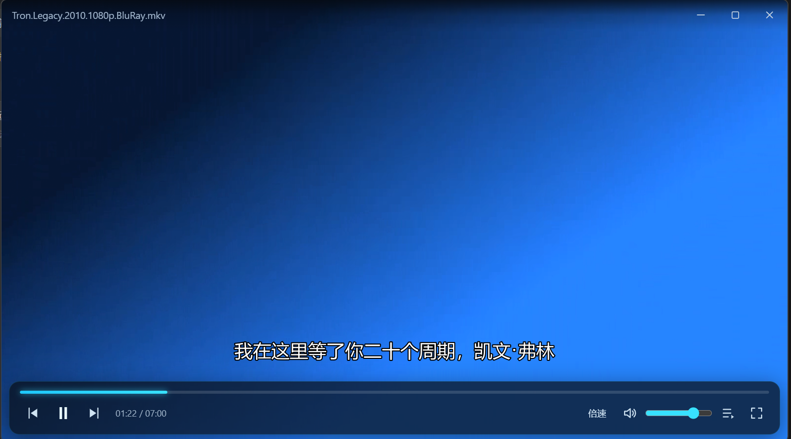

# uuplayer

<div align="center">

**参照 QQ影音 设计的 Windows 本地视频播放器** —— 界面简洁、全格式视频音频通吃（含网络流），纯本地离线运行，无广告、无后端依赖。

[](https://github.com/zouni88/uuplayer/releases)
[](https://github.com/zouni88/uuplayer/releases)
[](./LICENSE)
[](https://github.com/zouni88/uuplayer/stargazers)

**[下载最新版](https://github.com/zouni88/uuplayer/releases)** · **[在线预览](https://zouni88.github.io/uuplayer/)** · **[报告问题](https://github.com/zouni88/uuplayer/issues)**



<sup>*实机截图：自绘控制栏 · 实时中文字幕 · mpv 硬解渲染*</sup>

</div>

## 为什么做它

市面上的播放器要么广告多、要么越来越重。uuplayer 想找回当年 QQ影音 那种"打开 → 播放 → 关掉"的纯粹体验：**解码交给 mpv，系统集成交给 Rust，界面交给 React**，各自只做擅长的事。

## 功能特性

| | |
|---|---|
| 🎬 **全格式通吃** | MP4 / MKV / AVI / FLV / WMV / MOV，视频音频一把抓，解码全部由内置 FFmpeg 完成，免装解码器 |
| 🌐 **网络流直连** | 贴上 URL 直接播，HLS、RTSP 等主流流媒体协议原生支持 |
| ⚡ **硬解加速** | 默认 `--hwdec=auto-safe` 硬件解码，高码率 4K 也流畅省电 |
| 💬 **音轨字幕自由切** | 多音轨 / 字幕轨一键切换，外挂字幕模糊自动匹配（`--sub-auto=fuzzy`） |
| 📋 **批量导入与记录** | 文件 / 文件夹多选批量导入，播放列表抽屉 + 最近播放记录 |
| 📸 **一键截图** | 名场面随手截，画面即所得 |

## 下载

前往 [GitHub Releases](https://github.com/zouni88/uuplayer/releases) 下载最新安装包，Windows 10/11 免安装解码器，解压即用。

## 技术架构

- **播放核心**：内置 mpv（解封装/解码完全基于 FFmpeg 8.x），支持几乎所有主流视频、音频格式及 HLS、RTSP 等网络流，无系统解码器依赖
- **桌面壳**：Tauri 2 + Rust，负责 mpv 子进程管理、窗口与 IPC
- **前端 UI**：React 19 + TypeScript + Vite，透明 WebView 悬浮于视频输出之上，实现自绘控制栏、OSD、播放列表等界面

### 工作原理

1. Rust 后端在主窗口内创建一个 Win32 子窗口作为视频输出宿主（`video_host.rs`），置于 z-order 底部
2. 以 `--wid` 参数将该宿主窗口句柄交给 mpv 子进程渲染视频（`mpv.rs`）
3. 通过 Windows 命名管道上的 JSON IPC 与 mpv 通信（播放控制、属性监听、事件回传）
4. 前端经 Tauri command/event 与后端交互，mpv 属性变化实时广播到 UI

## 目录结构

```
uuplayer/
└── frontend_player/              # Tauri 应用（前端 + 后端）
    ├── src/                      # React 前端
    │   ├── components/           # 标题栏、控制栏、OSD、播放列表抽屉、右键菜单等 UI 组件
    │   ├── lib/                  # mpv IPC 封装、格式化工具、最近记录
    │   └── state/                # 播放器全局状态（PlayerContext）
    └── src-tauri/                # Rust 后端
        ├── src/
        │   ├── mpv.rs            # mpv 子进程管理 + JSON IPC
        │   ├── video_host.rs     # 视频输出宿主子窗口（Win32）
        │   └── lib.rs / main.rs  # Tauri 入口与 command 注册
        ├── capabilities/         # Tauri 权限配置
        └── mpv/                  # 内置 mpv.exe 及全部 FFmpeg 依赖 DLL
```

## 开发

环境要求：Node.js、Rust（stable）、Windows 10/11。

```powershell
cd frontend_player
npm install

# 开发模式（热更新）
npm run tauri dev

# 构建发布包
npm run tauri build
```

## 参与贡献

欢迎 [提 issue](https://github.com/zouni88/uuplayer/issues) 反馈问题与建议；觉得不错的话，点个 [Star ⭐](https://github.com/zouni88/uuplayer/stargazers) 是对项目最好的支持。

## License

[Apache-2.0](./LICENSE) · 参照经典 QQ影音 体验设计，致敬那个干净纯粹的播放器时代。
